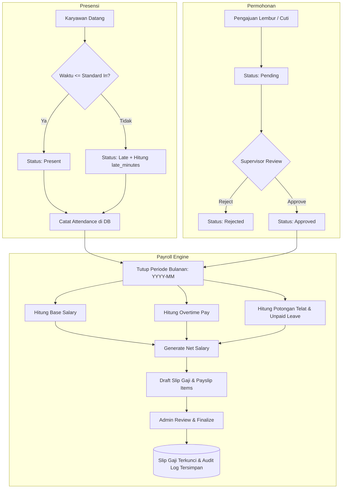
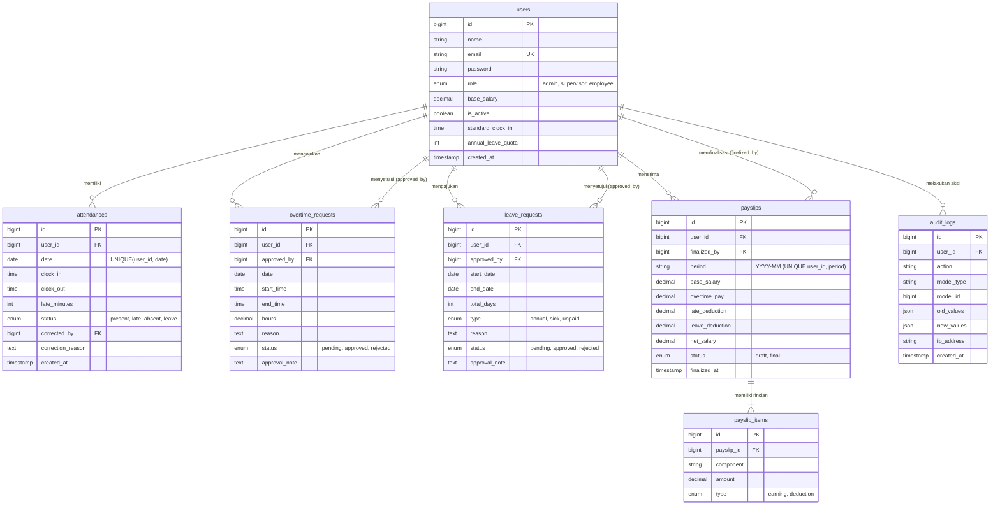

<p align="center">
  
</p>

<h1 align="center">💼 SiGaji (Sistem Informasi Gaji & Presensi Karyawan)</h1>

<p align="center">
  <strong>Solusi Komprehensif, Akurat, dan Transparan untuk Manajemen Presensi, Lembur, Cuti, serta Otomasi Penggajian Karyawan Berbasis Web.</strong>
</p>

<p align="center">
  
  
  
  
  
  
  
</p>

---

## 📌 Daftar Isi

1. [Latar Belakang & Studi Kasus](#-latar-belakang--studi-kasus)
2. [Fitur Utama](#-fitur-utama)
3. [Peran Pengguna (Role-Based Access)](#-peran-pengguna-role-based-access)
4. [Alur Bisnis Aplikasi (Workflow)](#-alur-bisnis-aplikasi-workflow)
5. [Skema Database & ERD](#-skema-database--erd)
6. [Tech Stack](#-tech-stack)
7. [Panduan Instalasi](#-panduan-instalasi)
8. [Struktur Direktori](#-struktur-direktori)
9. [Keamanan & Pencegahan Fraud](#-keamanan--pencegahan-fraud)
10. [Lisensi & Kontribusi](#-lisensi--kontribusi)

---

## 🏢 Latar Belakang & Studi Kasus

### 📖 Studi Kasus: *PT Inovasi Mandiri Pratama*
**PT Inovasi Mandiri Pratama** adalah perusahaan berkembang dengan puluhan karyawan yang memiliki mobilitas dan jadwal kerja dinamis. Sebelumnya, pengelolaan presensi dan penggajian masih menghadapi masalah klasik:

* ⏱️ **Keterlambatan Manual:** Menghitung menit keterlambatan dari data mentah memakan waktu 3–5 hari setiap akhir bulan.
* 💬 **Pengajuan Cuti & Lembur Informal:** Permohonan izin cuti dan lembur dilakukan melalui pesan chat singkat, seringkali tercecer dan tidak tercatat di rekapitulasi gaji.
* 💸 **Sengketa Nominal Slip Gaji:** Karyawan sering memprotes potongan gaji karena rincian komponen pendapatan dan denda tidak transparan.
* 🔍 **Potensi Manipulasi Data (Fraud):** Tidak adanya sistem pelacakan (*audit trail*) saat admin/supervisor merevisi jam presensi karyawan.

### 💡 Solusi: SiGaji
**SiGaji** hadir sebagai platform terintegrasi yang menjembatani operasional harian (presensi, izin, lembur) dengan sistem kalkulasi payroll otomatis:
1. **Pencatatan Presensi Terkunci:** 1 karyawan hanya memiliki 1 catatan presensi per tanggal dengan kalkulasi menit keterlambatan otomatis berdasarkan `standard_clock_in`.
2. **Approval Terstruktur:** Pengajuan lembur dan cuti membutuhkan persetujuan supervisor/admin sebelum masuk ke antrean payroll.
3. **Kalkulasi Payroll Deterministik:** Formula penggajian terperinci memisahkan *earnings* (gaji pokok, uang lembur) dan *deductions* (potongan telat, cuti tidak berbayar).
4. **Audit Trail Anti-Fraud:** Seluruh koreksi data absensi dan finalisasi gaji tercatat otomatis dalam tabel `audit_logs` beserta IP address dan rekam jejak nilai lama vs nilai baru.

---

## ✨ Fitur Utama

| Modul | Deskripsi Fitur |
|---|---|
| 🕒 **Presensi Harian** | • Clock-in dan Clock-out satu pintu.<br>• Deteksi otomatis menit keterlambatan (`late_minutes`).<br>• Status presensi: `present`, `late`, `absent`, `leave`.<br>• Mekanisme koreksi absensi dengan validasi alasan & supervisor ID. |
| ⏳ **Pengajuan Lembur (Overtime)** | • Formulir pengajuan jam mulai, jam selesai, estimasi durasi (`hours`), dan justifikasi tugas.<br>• Dashboard persetujuan berjenjang bagi Supervisor/Admin.<br>• Akumulasi jam lembur disetujui otomatis dihitung ke slip gaji. |
| 🌴 **Manajemen Cuti (Leave)** | • Pengecekan saldo kuota cuti tahunan (`annual_leave_quota`).<br>• Pengajuan ragam tipe cuti: Tahunan (`annual`), Sakit (`sick`), & Tanpa Gaji (`unpaid`).<br>• Integrasi langsung ke status presensi dan pemotongan gaji (*unpaid leave*). |
| 💵 **Payroll Engine (Slip Gaji)** | • Otomasi kalkulasi pendapatan kotor, tunjangan, lembur, dan potongan.<br>• Status slip gaji bertahap: `draft` (peninjauan) dan `final` (dikunci).<br>• Cetak/ekspor slip gaji yang transparan dan rinci. |
| 🧾 **Rincian Komponen (Payslip Items)** | • Rincian terpisah untuk setiap komponen penambah (`earning`) dan pemotong (`deduction`).<br>• Memudahkan audit finansial dan meningkatkan transparansi bagi karyawan. |
| 🛡️ **Audit Logging System** | • Pencatatan otomatis setiap aktivitas krusial (`attendance.corrected`, `payroll.finalized`).<br>• Relasi polimorfik (`model_type`, `model_id`) yang dapat memantau model apa pun.<br>• Menyimpan data perubahan dalam format JSON (`old_values` & `new_values`). |

---

## 👥 Peran Pengguna (Role-Based Access)

```
                 ┌────────────────────────────────────────────────────────┐
                 │                      ROLE ACCESS                       │
                 └────────────────────────────────────────────────────────┘
                       │                     │                     │
                       ▼                     ▼                     ▼
               ┌───────────────┐     ┌───────────────┐     ┌───────────────┐
               │     ADMIN     │     │  SUPERVISOR   │     │   EMPLOYEE    │
               └───────────────┘     └───────────────┘     └───────────────┘
               • Kelola Karyawan     • Verifikasi Absensi  • Clock In/Out
               • Finalisasi Gaji     • Approval Lembur     • Ajukan Lembur
               • Audit Log Viewer    • Approval Cuti       • Ajukan Cuti
               • Setting Perusahaan  • Koreksi Presensi    • Lihat Slip Gaji
```

1. **Admin (HR / Keuangan):**
   - Memiliki wewenang penuh atas master data karyawan dan gaji pokok (`base_salary`).
   - Menghasilkan draf slip gaji bulanan, memeriksa selisih, dan melakukan finalisasi slip gaji (`finalized_by`).
   - Mengakses log audit sistem untuk audit forensik.
2. **Supervisor:**
   - Mengawasi kedisiplinan tim kerja.
   - Melakukan koreksi presensi bawahan jika terjadi kendala teknis (wajib mencantumkan alasan).
   - Menyetujui atau menolak pengajuan lembur dan cuti karyawan.
3. **Employee (Karyawan):**
   - Melakukan presensi harian secara mandiri.
   - Mengajukan permohonan lembur dan cuti.
   - Memantau saldo cuti dan melihat histori slip gaji bulanan secara transparan.

---

## 🔄 Alur Bisnis Aplikasi (Workflow)



---

## 🗄️ Skema Database & ERD

### Entity Relationship Diagram (Mermaid)



---

## 🛠️ Tech Stack

* **Backend Framework:** [Laravel 13.x](https://laravel.com) (`v13.43.0`)
* **Bahasa Pemrograman:** PHP 8.5+ (minimum `^8.3` sesuai `composer.json`, aktif: `v8.5.11`)
* **Basis Data:** MariaDB 11.8+ (`11.8.8-MariaDB`) / MySQL 8.x
* **ORM:** Eloquent ORM (dengan deklarasi tipe relasi eksplisit `: BelongsTo`, `: HasMany`, `: MorphTo`)
* **Frontend:** Blade Templating + Tailwind CSS / Bootstrap 5 (CDN-first approach)
* **Paket CLI & Dev:** Laravel Tinker 3.x, Laravel Pail, Laravel Pint
* **Arsitektur Testing:** PHPUnit 12.x (`v12.5.12`)

---

## 🚀 Panduan Instalasi

### 1. Prasyarat Sistem
Pastikan perangkat Anda telah terinstal:
* PHP >= 8.3 (direkomendasikan PHP 8.5+ dengan ekstensi `pdo_mysql`, `mbstring`, `openssl`, `bcmath`)
* Composer >= 2.10.x
* MariaDB >= 11.8 / MySQL Server

### 2. Kloning Repositori
```bash
git clone git@github.com:uroo-dev/SiGaji.git
cd SiGaji
```

### 3. Instal Dependensi Composer
```bash
composer install
```

### 4. Konfigurasi Lingkungan (`.env`)
Salin file konfigurasi contoh dan sesuaikan akses database:
```bash
cp .env.example .env
php artisan key:generate
```

Sesuaikan parameter database di file `.env`:
```env
DB_CONNECTION=mysql
DB_HOST=127.0.0.1
DB_PORT=3306
DB_DATABASE=sigaji_db
DB_USERNAME=root
DB_PASSWORD=
# Jika menggunakan Linux unix socket (opsional):
# DB_SOCKET=/var/lib/mysql/mysql.sock
```

### 5. Jalankan Migrasi Database
Jalankan migrasi untuk membuat seluruh tabel dan relasi:
```bash
php artisan migrate
```

*(Opsional: Jika ingin mengulang migrasi dari awal)*
```bash
php artisan migrate:fresh
```

### 6. Jalankan Server Pengembangan
```bash
php artisan serve
```
Aplikasi kini dapat diakses melalui peramban di: `http://127.0.0.1:8000`

---

## 📁 Struktur Direktori Penting

```
sigaji/
├── app/
│   ├── Http/
│   │   └── Controllers/       # Controller logika bisnis
│   └── Models/
│       ├── Attendance.php     # Model Presensi harian
│       ├── AuditLog.php       # Model Audit jejak aksi (Polymorphic)
│       ├── LeaveRequest.php   # Model Pengajuan Cuti
│       ├── OvertimeRequest.php# Model Pengajuan Lembur
│       ├── Payslip.php        # Model Slip Gaji induk
│       ├── PayslipItem.php    # Model Rincian komponen slip gaji
│       └── User.php           # Model Pengguna & Role
├── config/                    # File konfigurasi Laravel
├── database/
│   ├── migrations/            # Skrip skema database
│   └── seeders/               # Data awal (dummy/admin)
├── resources/
│   └── views/                 # Tampilan antarmuka Blade
└── routes/
    └── web.php                # Rute aplikasi web
```

---

## 🔐 Keamanan & Pencegahan Fraud

1. **Unique Constraints Anti-Duplikasi:**
   - Tabel `attendances` menerapkan `UNIQUE(user_id, date)` mencegah double clock-in pada hari yang sama.
   - Tabel `payslips` menerapkan `UNIQUE(user_id, period)` menjamin tidak terjadi penerbitan slip gaji ganda dalam 1 bulan periode.
2. **Koreksi Absensi Terkendali:**
   - Jam absensi tidak dapat diubah tanpa mencatat siapa yang mengoreksi (`corrected_by`) dan wajib menyertakan alasan (`correction_reason`).
3. **Karantina Slip Gaji:**
   - Status `draft` memungkinkan review dan audit sebelum status diubah menjadi `final`. Slip gaji yang sudah `final` dikunci dari modifikasi otomatis.
4. **Jejak Audit Real-Time:**
   - Setiap mutasi data kritis otomatis disimpan ke `audit_logs` bersama rekaman `ip_address` pelaku dan snapshot data sebelum/sesudah perubahan.

---

## 📄 Lisensi & Kontribusi

Proyek ini berada di bawah lisensi [MIT License](LICENSE).  
Dikembangkan dengan ❤️ oleh **[uroo-dev](https://github.com/uroo-dev)** untuk kemudahan dan efisiensi manajemen ketenagakerjaan.
